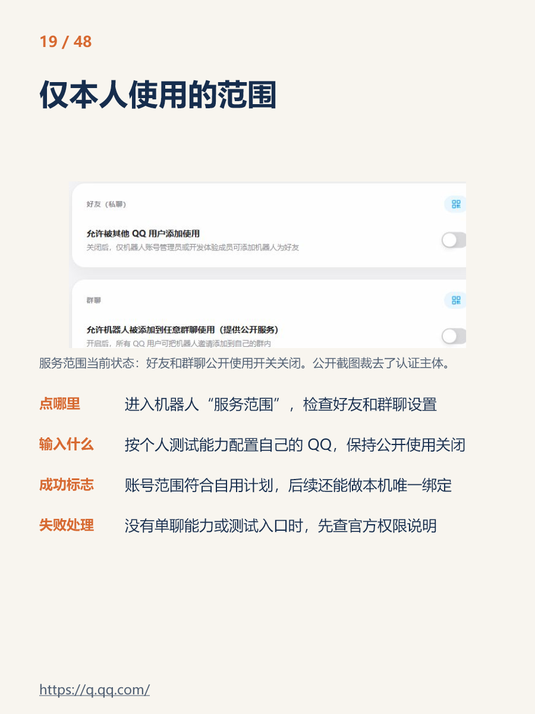
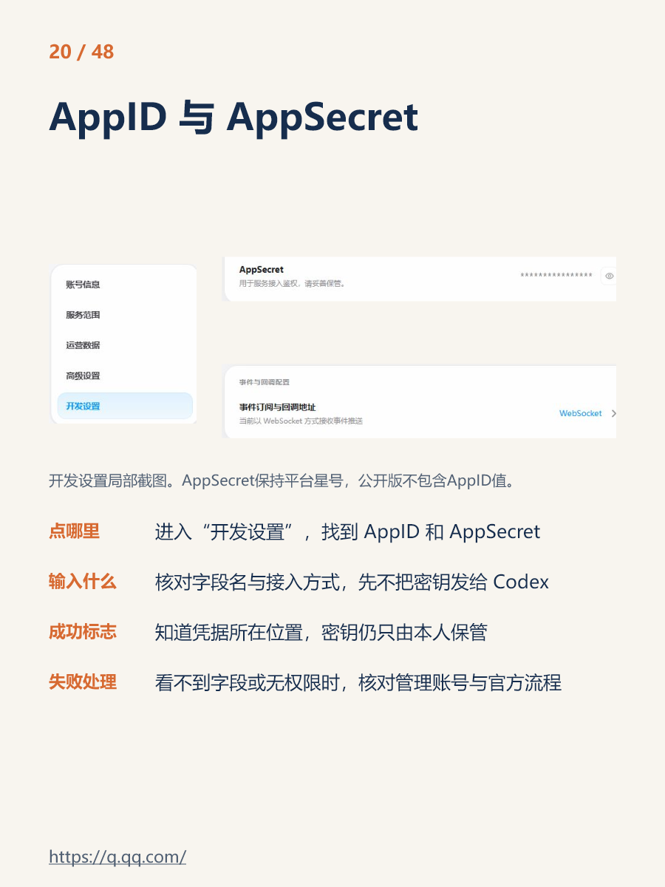

# 把工作通知发给 QQ，让 DeepSeek 帮我挑出重点：附源码和云端安装步骤

工作群里的通知经常夹着时间、地点和附件。看过时觉得记住了，隔几天又得回去翻。我想做的事很简单：遇到需要处理的通知，主动发给一个只供自己使用的机器人，让它先告诉我做什么、什么时候做，以及哪里还需要确认。

最初我在自己的电脑上测试，后来把程序迁到了云服务器，分析服务改接 DeepSeek。现在，电脑关机后仍可以在 QQ 里使用。为了让别人少走一遍开发过程，我把程序里的个人资料、账号凭据和工作记录全部移除，整理成了这份配套源码。

本文对应源码包 v1.1.0，更新于 2026 年 10 月 22 日。后续平台界面、模型名和优惠可能变化，请以自己账号看到的页面为准。步骤中的示例姓名、时间和路径只用于演示，不是作者的工作信息。

**源码与教程：** [GitHub 仓库](https://github.com/SHAWZHANG360/qq-work-assistant) · [v1.1.0 源码包](https://github.com/SHAWZHANG360/qq-work-assistant/raw/refs/heads/main/qq-work-assistant-v1.1.0.zip)。初次阅读建议看仓库中的最新教程。版本 ZIP 内的教程是发布时的快照，后续说明以仓库最新文本为准。下载源码不需要填写作者的任何配置；你要准备自己的 QQ 机器人、DeepSeek API 账号和服务器。

## 可以先让 Agent 帮你做

如果使用 Codex、Claude Code 等带终端工具的 Agent，可以把本仓库链接和 [Agent 部署流程](AGENT_SETUP.md) 里的提示词一起发给它。Agent 会先检查已有条件，再执行可自动完成的步骤。注册认证、付款、输入密钥和本人 QQ 绑定由你完成，每一步都有网址和成功标志。仅能聊天的助手不能自动操作服务器。

## 先看成品能做什么

你把一条通知发给机器人，它会提取重点，默认最多列三项，并附上这条消息的模型用量。完整结果在管理页中展开。不要把简短回复当成全部材料：长附件里可能还有次要事项，要看完整依据。

| 材料或操作 | 当前支持的范围 |
|---|---|
| 文字 | 重点事项、本人相关性、时间、地点、待确认问题和原文依据 |
| 图片 | PNG、JPEG、WebP；先识字，再整理，通常有两次模型调用 |
| 文件 | PDF、DOCX、XLSX、PPTX、TXT、CSV 的可提取文字 |
| 提醒 | 明确未来时刻按原文；无具体时刻收到后3小时；时间已过不新建；发送“提醒”查看、“取消提醒”取消全部待发送项 |
| 今日重点 | 私聊发送 `/today`，查看当天已处理事项中的最多三项，不额外调模型 |
| 查看用量 | QQ 回复显示本条用量；管理页显示输入、缓存、输出和调用记录 |
| 调整模型 | 管理页修改文字模型、图片模型和思考强度，保存后应用于后续任务 |
| 身份限制 | 只接受已绑定本人的私聊；别人即使知道姓名关键词，也不能使用 |

**还没有做的功能：** 自动写入手机日历、自动判断事项完成、跨通知语义去重、展开所有合并转发卡片、处理语音。`/today` 也不是完整任务管理系统。

文件每条最多 3 个，单个不超过 10MiB、合计不超过 20MiB；图片一次最多 4 张，单张不超过 10MiB、合计不超过 20MiB。解析会限制长度，长文件可能截断。扫描 PDF、Office 文件里的嵌入图片、老式 DOC/XLS/PPT、压缩包和受密码保护的文件不在本版支持范围内。遇到这些材料，改发清晰截图、复制正文，或另存为支持的格式。

## 1. 先分清每个东西负责什么

整个流程是这样：

```text
你在 QQ 私聊发送通知
       ↓
腾讯官方机器人接口（QQ AppID + AppSecret）
       ↓
你的云服务器：检查是不是绑定本人 → 保存消息 → 排队
       ├─ 文字：直接准备分析内容
       ├─ 图片：安全下载 → DeepSeek 识字 → 准备分析内容
       └─ 附件：下载或管理页上传 → Python 提取正文
       ↓
DeepSeek API：提取待办、时间、依据和待确认项
       ↓
服务器保存完整结果和 API 用量 → QQ 回复具体动作和时间
       ↓
提醒队列持久保存 → 每30秒检查 → 按平台权限向本人发送到期提醒

你的电脑 ── SSH 加密隧道 ── 管理页（设置模型、查看结果、上传附件）
```

QQ 是聊天入口，DeepSeek 是负责分析的模型，服务器负责把二者连起来并一直运行。systemd 是 Ubuntu 自带的服务管理工具，让助手在后台运行、开机启动、异常退出后尝试重启。

**不需要 OpenClaw，也不需要运行时开着 Codex。** Codex 可以协助你改程序、排错，但下载这份源码后不必先让它生成一遍代码。你也不需要把个人 QQ 的登录密码交给程序。

“只给自己用”是访问限制，不代表数据完全不离开设备。消息经过腾讯；待分析的正文、图片或文件提取文字会发给 DeepSeek；原始材料和结果保存在自己的服务器。请先用虚构通知测试，工作资料按单位要求处理。


## 搭建好以后：每天怎样用

第一次搭建按下面第 2—13 步完成；已经通过四项验收后，平时不需要重复安装、重新绑定或打开终端。

1. **挑通知。** 在原工作会话中选出需要处理的内容，复制正文或转发给自己机器人的私聊。它不会替你读取其他群聊。
2. **补上下文。** 原文写“明天”“本周五”时，一起写明原通知发布日期；任务属于附件时把原文件也发过去。可以补一句“重点提取我需要做的事和截止时间”。
3. **等结果。** 看见“正在分析”表示已接收，收到重点与用量才表示这次处理已完成。不要因为等待几秒就重复发送。
4. **先看最重要的三项。** 看做什么、何时完成、还缺什么。日期、金额、责任人要对照原文；不清楚的内容保留为待确认。
5. **需要完整材料时打开管理页。** 通过自己的 SSH 隧道查看完整依据、历史结果和用量；QQ 文件无法下载时在管理页上传原文件。网页上传的结果在网页查看。
6. **收工前发 `/today`。** 它读取当天已有结果，不再付一次模型分析费用，最多列三项。要看全部记录，到管理页查；它不会把完成的事项自动勾掉。

例如，可以直接发送下面这段虚构内容：

> 原通知发布于 2027-01-10。请示例部门在明天下午 5 点前交会议材料，接收邮箱稍后补充。请整理我的待办、明确截止时间，并标出缺少的信息。

发现内容在截图里，就直接发清晰图片；扫描 PDF 或文档内图片则先截出相关页面。本版支持 QQ 定时提醒：有明确日期时刻则按原文；没有具体时刻则安排收到后 3 小时；原文时间已过则标注“时间已过”且不新建提醒。重要事项仍建议另设可靠闹钟，QQ 主动消息受平台权限和额度限制。不会自动写入手机日历。

### 费用和在线状态怎么理解

QQ 是入口，云服务器是一直运行的程序，DeepSeek API 是按调用计费的分析服务。花的是部署者自己的服务器费用和 DeepSeek API 余额，不是教程作者的额度。文字通常一次分析；图片通常识字一次、整理一次。具体用量看本条回复和管理页，金额以 DeepSeek 账单为准。

自己的电脑、浏览器、Codex、SSH 管理隧道都可以关闭；云服务器及助手服务必须运行。服务器到期、API 余额不足、QQ 密钥失效、网络故障都可能中断使用，按第 16 步排查。

### 只想改模型时

打开管理页 → 找到“模型设置” → 选择程序支持的文字模型和思考强度 → 保存 → 发一条虚构通知比较结果和用量。设置只影响下一条任务，不会自动重做之前的分析。先从默认设置开始，遇到需要复杂判断的内容再调整。

## 2. 收藏这些网站，别把几个后台混在一起

| 用途 | 官方入口 |
|---|---|
| 创建和管理 QQ 机器人 | [QQ 开放平台](https://q.qq.com/) |
| 本次用过的机器人入口 | [QQ 机器人创建入口](https://q.qq.com/qqbot/openclaw/) |
| 核对 QQ 接入权限和事件 | [腾讯官方机器人文档](https://bot.q.qq.com/wiki/) |
| DeepSeek 登录、余额和用量 | [DeepSeek 开放平台](https://platform.deepseek.com/) |
| 创建 DeepSeek 密钥 | [API Keys](https://platform.deepseek.com/api_keys) |
| 核对模型能力和单价 | [DeepSeek 模型与价格](https://api-docs.deepseek.com/zh-cn/quick_start/pricing/) |
| 比较阿里云活动 | [官方优惠活动](https://www.aliyun.com/benefit/select/cloud-discount) |
| 轻量服务器产品 | [轻量应用服务器](https://www.aliyun.com/product/swas) |
| 查看自己的服务器 | [轻量服务器控制台](https://swasnext.console.aliyun.com/) |
| 查支付与订单状态 | [阿里云订单](https://billing-cost.console.aliyun.com/order/list) |
| Workbench 和 SSH 连接说明 | [连接 Linux 服务器](https://help.aliyun.com/zh/simple-application-server/user-guide/connect-to-linux-server-remotely) |
| Node.js 官方下载来源 | [Node.js](https://nodejs.org/en/download) |
| Python 附件解析依赖 | [pypdf](https://pypi.org/project/pypdf/) |

QQ 互联、腾讯频道 Skill 和本教程的 QQ 私聊机器人不是同一个配置入口。创建入口的网址里出现 `openclaw`，也不代表必须安装 OpenClaw。

## 3. 不急着付款，先确认 QQ 机器人能创建

1. 打开 QQ 开放平台，用自己准备使用的 QQ 扫码登录，在手机上确认。
2. 没有开发者身份时，按页面注册。个人使用选择适合自己的个人主体，按官方提示实名认证。身份证、验证码、人脸认证都在官方页面完成，不发给 AI 或教程作者。
3. 进入机器人列表，选择创建机器人。填写自己的名称、头像和用途，例如“个人通知整理助手”。不要复制作者的账号、名称或添加链接。
4. 创建后进入管理页，找到“服务范围”或对应的体验、测试成员设置。
5. 选择仅供自己测试的范围，把自己将要聊天的 QQ 加到可用成员中；若平台需要邀请、审核或其他条件，先完成这些条件。不要为了本教程开放给所有人。
6. 按后台提供的“添加机器人”、二维码或分享入口，在 QQ 里打开它的私聊。**暂时没回复正常，因为程序还没启动。** 但你需要先确认自己有可用的私聊入口。

下面是隐藏账号信息后的页面示例，取自较早的操作记录；图中“本机绑定”在本版改为云端程序绑定，具体以本文步骤为准。平台改版后布局可能不同，重点找“服务范围”和自己的测试成员。



如果创建入口没有开放、个人主体不支持所需能力，或后台没有私聊测试权限，先查官方说明。不要先买服务器再赌权限会出现，也不要改用模拟个人 QQ 登录的软件来绕过平台限制。

进入同一个机器人的“开发设置”，找到 **AppID** 和 **AppSecret**。AppID 是机器人编号；AppSecret 是接入密钥。两者必须属于同一个机器人。点击眼睛图标显示完整密钥，后面配置时直接复制；页面上的星号不能当密钥使用。



如果后台要求设置 IP 白名单，等拿到服务器后填写自己的服务器出口公网 IPv4，并保存。不要填自己电脑的内网地址。本程序使用主动建立的官方 WebSocket 连接接收私聊事件，不需要把管理页地址填成回调 URL；平台若只给你其他接入方式，先确认权限与文档，不能直接套用本程序。

## 4. 准备 DeepSeek API，网页聊天账号本身不够

1. 打开 DeepSeek 开放平台，登录自己的账号。
2. 进入余额或充值页面，按自己的预算准备少量可用 API 余额。API 使用费和服务器费用分开计算。
3. 进入 API Keys 页面，创建一把仅用于本助手的密钥，名称可以叫 `qq-assistant`。
4. 按平台提示保存密钥。以后只在服务器的配置向导中填写，不发到 QQ、Codex 对话、知乎评论或 GitHub Issue。
5. 查看官方模型页面，核对账号能用的模型。本版支持 `deepseek-flash` 和文字用途的 `deepseek-v4-pro`；图片使用 Flash。若平台已更名，请先更新程序兼容性，不要只把界面里的名字改掉。

DeepSeek 网页聊天能用，不等于 API 有余额。配置向导会验证密钥和模型列表，但余额是否足够完成一次分析，需要后面的实际测试确认。

## 5. 购买服务器：看清周期和总价

本教程安装脚本面向 **Ubuntu 24.04 系统镜像、2GB 或更大内存、x86_64 或 ARM64**。个人轻量使用可从 2 核 2GB、40GB 系统盘考虑；这不是硬性容量保证，附件长期积累需要定期检查磁盘。不要选择 Windows、CentOS 或预装 OpenClaw 应用镜像。

购买顺序：

1. 登录阿里云，按平台要求完成个人实名认证。
2. 在活动页对照自己账号实际能买的套餐，不只看广告标题。
3. 确认是轻量应用服务器还是 ECS。这份安装流程可以用于符合条件的 Ubuntu 服务器，但两种产品的控制台入口不同。
4. 选择地域、Ubuntu 24.04 系统镜像、1 台、1 年。地域按自己的使用位置与服务可达性选择，不必照抄作者地域。
5. 核对系统盘、带宽或流量套餐、是否有超额费用、续费价格、是否启用自动续费。
6. 阅读服务协议，确认应付金额后本人付款。
7. 回订单列表核对“已支付”，再进入对应产品控制台，等待服务器显示运行中。

我这次实际买到的是 **68 元一年** 的套餐，API 另付。过程中也看过 38 元限量活动，但页面提示不满足资格；更便宜的广告还要核对购买时长、套餐档位和限制。这里记录的是这次购买经历，不能保证你用相同价格买到。订单不为空、没有资格或支付状态不清楚时，先核对订单，别反复付款。

## 6. 打开服务器终端，分清命令在哪里执行

以下两种窗口不是同一个地方：

| 文中标记 | 在哪里执行 |
|---|---|
| `bash` | 已连接到自己服务器的 Workbench / SSH 终端 |
| `powershell` | 自己 Windows 电脑上的 PowerShell |
| 绑定指令、虚构通知、`/today` | 自己 QQ 中与机器人的私聊 |
| API 密钥 | 后面配置向导显示“不回显”的输入位置 |

代码块只复制框内命令，不复制 `bash`、`powershell` 或反引号。命令提示符前面的 `$`、`#` 也不需要手动输入。

在阿里云控制台打开自己的实例，记录公网 IPv4 和到期日。点击“远程连接”，按官方提示通过 Workbench 连接，完成认证后看到终端。执行：

```bash
whoami
cat /etc/os-release
uname -m
df -h /
```

`whoami` 输出当前登录用户名，记下来，后面的 SSH 命令要用。Ubuntu 轻量镜像可能使用 `admin`，也可能是别的账号，**以实际输出为准**。系统应为 Ubuntu 24.04，架构是 `x86_64` 或 `aarch64`。系统不符时不要执行安装脚本；新机器没有数据可考虑在控制台重新选择系统，但重装会清空数据，必须先确认。

## 7. 下载配套源码并上传

**初学者建议走 ZIP 路线，不用先学 Git。**

1. 在自己的电脑浏览器打开仓库主页。公开仓库可以直接浏览和下载，不需要 GitHub Token。
2. 点击绿色 `Code`，再点 `Download ZIP`。不要把网页另存为 HTML。
3. 下载完成后，文件名一般是 `qq-work-assistant-main.zip`；作者直接给你的包可能叫 `qq-work-assistant-v1.1.0.zip`。
4. 在 Workbench 的文件管理/上传功能中，把 ZIP 上传到当前用户的主目录。不同版本可能在工具栏或侧边栏；不确定目录时，在终端运行 `pwd`。
5. 回服务器终端执行下面三行，先准备一个目录。

```bash
mkdir -p ~/qq-assistant-install
cd ~/qq-assistant-install
ls -lh ~/*.zip
```

最后一行用来查看上传文件的名字。如果没有找到，说明文件没有放在主目录。先回文件管理确认位置，不要继续复制一个猜出来的路径。

安装解压工具：

```bash
sudo apt-get update
sudo apt-get install -y unzip
```

下面假设下载的是 GitHub ZIP；文件名不同，把该文件名替换为 `ls` 看到的真实名字：

```bash
unzip ~/qq-work-assistant-main.zip
ls
```

GitHub ZIP 通常解压为 `qq-work-assistant-main`；作者源码包解压为 `qq-work-assistant`。进入**实际出现的那个文件夹**，例如：

```bash
cd qq-work-assistant-main
ls
```

看到 `README.md`、`install.sh`、`configure.py`、`main.mjs` 才算进对目录。如果 `bash install.sh` 提示找不到文件，最常见原因就是还在上一级。

如果服务器能访问 GitHub，也可用下面的替代路线；它与 ZIP 路线二选一，不必重复：

```bash
sudo apt-get update
sudo apt-get install -y git
git clone https://github.com/SHAWZHANG360/qq-work-assistant.git
cd qq-work-assistant
```

不要把 GitHub Token 拼进下载命令或 URL，公开下载不需要它。服务器连不上 GitHub 时，用本机下载再上传的方式，不必修改网络安全设置。版本页中的源码 ZIP 若先打开文件预览，点击右上方 `Download raw file` 下载；不要复制预览文字。

## 8. 执行安装，先不填任何密钥

在刚才能看到 `install.sh` 的服务器目录执行：

```bash
sudo bash install.sh
```

脚本会检查系统与架构，从官方来源下载并校验 Node.js 24，建立 Python 环境、安装固定版本的 pypdf，创建低权限运行用户，注册 systemd 服务。它不会替你购买东西，也不会自动填入账号密钥。

下载可能需要几分钟。等终端出现“安装完成，尚未启动”再继续。**没有看到这句话，就先处理错误，不能当成已经安装成功。**

安装位置如下，通常不需要你改：

| 位置 | 保存什么 |
|---|---|
| `/opt/qq-work-assistant` | 程序、Node.js、Python 环境 |
| `/etc/qq-work-assistant/config.json` | 你稍后填写的真实配置，只有 root 可直接读写 |
| `/var/lib/qq-work-assistant` | 绑定身份、消息、附件、分析结果和用量 |
| `qq-work-assistant.service` | 后台运行和开机启动设置 |

脚本发现已有安装或数据会停止，避免覆盖。**旧版本用户不要用删除目录的方式绕过去。** 先阅读后面的维护部分，再评估升级或迁移；首次安装流程不负责自动迁移旧助手。

## 9. 填自己的配置：就在这个服务器终端里

执行：

```bash
sudo python3 /opt/qq-work-assistant/configure.py
```

向导依次询问：

| 提示 | 填什么 |
|---|---|
| 机器人 AppID | 腾讯后台该机器人的完整 AppID，只有数字，不加引号 |
| QQ AppSecret（不回显） | 同一个机器人的完整密钥 |
| DeepSeek API Key（不回显） | 自己在 DeepSeek 开放平台创建的 API Key |
| 姓名 | 可选，用于判断通知是否与你有关 |
| 单位 | 可选，用于相关性判断 |
| 部门 | 可选，用于相关性判断 |

每填一项按一次 Enter。**密钥输入时屏幕不出现字符和星号，这是正常的。** 粘贴一次后按 Enter，不要因为看不到而连贴两次。不要把密钥写成一条终端命令，也不要截图记录。

程序会分别验证腾讯凭据、QQ 网关和 DeepSeek 模型列表。只有全部通过才一起保存。看到“配置已验证并保存”再往下走；验证失败不会覆盖之前成功保存的配置。

常见错误：

- 腾讯没有返回有效凭据：重新确认 AppID 与 AppSecret 属于同一个机器人，复制的不是遮盖星号，也不是腾讯频道登录 token。
- DeepSeek HTTP 401：检查是否复制完整密钥、是否已撤销。
- 网络或证书错误：确认服务器时间正确、能访问官方接口，不要关闭 HTTPS 证书校验。
- 没有 `deepseek-flash`：先核对当前账号模型目录和源码版本。不要随便替换为另一个名字，因为图片和输出格式也要兼容。
- 向导要求交互终端：在 Workbench 直接运行，不能通过 `echo 密钥 | ...` 喂给程序。

重新运行同一命令可以修改配置；已有值时直接回车保留，姓名等字段填 `-` 可清空。程序已经运行后，修改完还需重启服务才生效。

## 10. 启动后台服务，检查是不是正常运行

执行：

```bash
sudo systemctl enable --now qq-work-assistant
sudo systemctl status qq-work-assistant --no-pager
```

`active (running)` 表示进程已运行，**还不等于 QQ 已连接或模型已验证**。再检查管理服务的健康接口：

```bash
curl -fsS http://127.0.0.1:18080/health
```

正常会返回包含 `"running":true` 的 JSON。这只是确认进程能响应，本人绑定和真实分析还要在后面验收。

失败时看最近日志：

```bash
sudo journalctl -u qq-work-assistant -n 50 --no-pager
```

程序刻意不把密钥写入错误日志。若需要向别人求助，只提供清理后的错误提示，不要提供配置文件内容、整份数据目录或管理页 HTML。

## 11. 建立 SSH 隧道，打开管理页

管理页默认不对公网开放。你在自己电脑建立一条 SSH 通道，再从浏览器访问它。**以后日常在 QQ 收发消息不需要一直保持这条通道，只有管理时需要。**

### 11.1 在 Windows 准备 SSH 密钥

在 Windows 开始菜单搜索 PowerShell 并打开，执行：

```powershell
ssh -V
```

能显示 OpenSSH 版本即可。提示找不到命令时，到 Windows“设置 → 可选功能”中安装 OpenSSH 客户端，再重新打开 PowerShell。

执行下面两行，检查拟用的文件名有没有被占用：

```powershell
New-Item -ItemType Directory -Force "$env:USERPROFILE\.ssh" | Out-Null
Test-Path "$env:USERPROFILE\.ssh\qq_assistant"
```

结果为 `False` 时，生成本助手专用密钥：

```powershell
ssh-keygen -t ed25519 -f "$env:USERPROFILE\.ssh\qq_assistant"
```

按提示设置一个自己记得住的私钥口令，第二次输入用于确认，输入同样不回显。若前一步是 `True`，不要覆盖已有私钥：可以使用确认属于自己的旧密钥，或者把后续所有 `qq_assistant` 改成一个新的文件名。

查看公钥：

```powershell
Get-Content "$env:USERPROFILE\.ssh\qq_assistant.pub"
```

复制输出的整整一行，通常以 `ssh-ed25519` 开头。**只复制 `.pub` 公钥，不打开或发送没有 `.pub` 后缀的私钥文件。**

### 11.2 把公钥加入自己的服务器账号

回到 Workbench 的服务器终端，执行 `whoami`，确认当前用户就是之后准备 SSH 登录的用户。执行：

```bash
mkdir -p ~/.ssh
chmod 700 ~/.ssh
cat >> ~/.ssh/authorized_keys
```

第三行执行后，终端会等你输入。粘贴刚才的**公钥整行**，按 Enter，再按 **Ctrl+D** 结束输入。这一步没有要求输入 API 密钥。随后执行：

```bash
chmod 600 ~/.ssh/authorized_keys
sudo ssh-keygen -lf /etc/ssh/ssh_host_ed25519_key.pub
```

最后一行显示服务器的主机密钥指纹。保留终端用于下一步对照，它和刚才生成的个人登录密钥不是一回事。

在阿里云实例的防火墙或安全组中，确认 TCP 22 允许从**自己电脑当前的公网 IP**访问。能限制来源时不要开放给所有地址；电脑更换网络后，来源 IP 可能需要更新。不需要开放 18080、80 或 443。若云端 Workbench 自身受规则影响，按官方连接指引保留它所需的访问方式。

### 11.3 在自己电脑连接

回到 Windows PowerShell，复制下面的命令前，先把 `登录用户名` 和 `服务器公网IP` 换成前面记下的实际值，其他部分保持不变：

```powershell
ssh -i "$env:USERPROFILE\.ssh\qq_assistant" -o ExitOnForwardFailure=yes -o ServerAliveInterval=30 -N -L 127.0.0.1:18080:127.0.0.1:18080 登录用户名@服务器公网IP
```

首次连接会显示服务器指纹，和 Workbench 查到的同种算法指纹一致后输入 `yes`。不一致先停下，不要删除已保存指纹硬连。输入刚才设置的**私钥口令**，不是 QQ 或 DeepSeek 密钥。

连接成功时窗口通常没有新的输出，光标停在那里，这是正常状态。**这个窗口先留着，不要关。** 在同一台电脑的浏览器打开：

[打开管理页（需先建立隧道）](http://127.0.0.1:18080/)

这里是读者自己建立隧道后使用的通用地址，不是作者的本机地址，也不是公网网址。请原样使用 `127.0.0.1`，不要改成服务器 IP 或 `localhost`，因为程序检查访问地址。

出现 `Address already in use` 表示电脑上的 18080 已被占用。先检查是否已有本助手的隧道窗口；关闭重复窗口，保留一条。如果有其他程序使用该端口，先停下排查，不要改管理服务的公网监听设置。

Mac/Linux 用户可以使用同样的 `ssh` 参数，把私钥路径替换为自己的路径。本文截图和本机命令按 Windows 写，其他系统的文件路径不完全相同。

## 12. 完成本人绑定，之后才发送工作材料

管理页上有三个状态：QQ 连接、本人绑定、分析服务。先等 QQ 显示已连接。

1. 找到本人绑定区域，点击复制绑定指令。
2. 回自己 QQ 中与**自己创建的机器人**的私聊。
3. 粘贴完整一行 `绑定 临时随机码` 并发送。不要只发“绑定”两个字，不要把示例码照搬过去。
4. 等机器人回复“本人绑定成功”。
5. 回管理页确认显示“已绑定本人”，临时码不再显示。

绑定码有效期 15 分钟。过期后刷新管理页，复制新的一行再发。不要把码发进群或教程截图里，拿到它的人在首次绑定前可能抢先绑定。绑定后程序按 QQ 的用户标识限制访问，不靠姓名判断。

绑定身份文件丢失时，程序会停止并提示恢复，不会自动放开给别人重新绑定。不要为了排错删除 `owner.json` 或整个数据目录。

如果发绑定指令没回复，按顺序检查：服务仍在运行 → 管理页 QQ 已连接 → 平台服务范围包含当前 QQ → 私聊的是自己的那个机器人 → 绑定码未过期。腾讯后台某处显示“已连接”，不代表你这台服务器的程序也连接成功了。

## 13. 做四次验收，再发真实通知

### 文字测试

在 QQ 私聊发一段虚构通知，日期可以改成未来的明确日期：

> 【虚构测试】请示例姓名于 2027 年 1 月 15 日 17:00 前提交示例部门的会议材料，提交到指定邮箱。邮箱地址待补充。

应该收到“正在分析”等处理提示，随后收到第一行的具体待办、时间或提醒安排，以及本条用量。模型不应凭空编造邮箱。管理页里应该能展开完整依据。

只收到第一句“正在分析”不算通过。失败时先看 DeepSeek 余额、网络、管理页错误，再决定是否手动重试。

### 图片测试

把虚构通知截图，作为一张清晰图片直接发给机器人。检查日期、数字和责任人是否识别正确。通常有识字、整理两次调用，用量会分别记录。

合并转发里的图片未必能被机器人拿到，遇到失败请直接发图片文件。把模糊截图发十次不会让原图变清晰；先换清楚的图。不得确认的内容应显示待确认。

### 附件测试

在 Word 新建一个只包含虚构内容的 `.docx`，保存后尝试发给机器人。若 QQ 没有把附件正文或可下载链接传给机器人，到管理页“上传附件”选择这个原文件，补充说明后提交。

从管理页上传的文件，结果在管理页查看；不要以是否收到 QQ 推送作为唯一判断。上传前必须已绑定本人。再试一个可选中文字的 PDF；纯扫描 PDF 需改发图片。

### 后台运行测试

在 QQ 发 `/today`，应看到当天重点。然后关闭自己电脑上的 SSH 隧道窗口和浏览器，再从手机 QQ 发另一条虚构通知。还能收到整理，说明运行已不依赖电脑上的管理窗口。

需要确认开机自启时，在服务器终端执行：

```bash
sudo systemctl is-enabled qq-work-assistant
sudo systemctl restart qq-work-assistant
sudo systemctl is-active qq-work-assistant
```

应依次看到 `enabled` 和 `active`。重启服务会短暂断开连接，避开正在分析时执行；完成后再发一条测试。服务器整机重启是另一项操作，不必为了看绿灯频繁重启。

## 14. 怎么省用量、怎么调整模型

默认文字与图片模型都是 DeepSeek Flash，思考强度为 `none`。先用默认设置观察效果，不要一开始就把每条通知都设成高强度推理。

管理页找到模型设置，修改文字模型、图片模型或思考强度，再点击保存。文字可选 Pro；图片只能选代码支持的图片模型。保存只影响后续任务，不自动重跑历史任务。当前可选目录与源码绑定，并非任意模型名都能直接填写。

程序主要通过几种方式控制消耗：只分析这次发送的材料，不重复带上全部聊天历史；对同一个 QQ 消息 ID 去重；限制输入、文件大小和输出；默认给简短重点；`/today` 读取已有结果。**重新发送同一段话通常产生新的消息 ID，仍会重新分析并收费。**

输入、输出、缓存 token 都以 API 返回为准，不存在“一次固定消耗多少”的准确承诺。缓存 token 是输入中的一部分，不能又加一遍；接口没返回用量时显示未记录，不按 0 计算。需要人民币金额时，以自己的 [DeepSeek 账单](https://platform.deepseek.com/) 和 [官方单价](https://api-docs.deepseek.com/zh-cn/quick_start/pricing/) 核对。

这套程序目前没有每日硬预算上限。想暂停花费，可以点“暂停自动分析”，但进程还会接收本人消息；完全停止服务则运行后面的停止命令。不要反复点测试或重试按钮验证同一个问题。

## 15. 日常维护只需记住这些操作

下面都在服务器终端执行：

```bash
# 查看运行状态
sudo systemctl status qq-work-assistant --no-pager
# 修改密钥或个人关键词
sudo python3 /opt/qq-work-assistant/configure.py
# 修改配置后重启
sudo systemctl restart qq-work-assistant
# 暂停整个服务
sudo systemctl stop qq-work-assistant
# 恢复整个服务
sudo systemctl start qq-work-assistant
# 查看磁盘剩余空间
df -h /
# 查看助手数据占用，不显示正文
sudo du -sh /var/lib/qq-work-assistant
```

运行配置文件、绑定身份和工作记录不在源码目录里。升级前，先用云平台快照或自己认可的私有备份方式保留服务器状态；确认快照可能产生的费用，备份也要按私人资料保护。不要把含密钥的备份传到源码仓库。

`install.sh` 只做首次安装。已安装通用版时，从单独下载的新版本目录运行 `sudo bash upgrade.sh`：脚本先测试并准备运行环境，停服务后备份配置和数据，再更新程序；失败会尝试恢复旧程序。记录备份位置并核验 QQ 收发。不要先把 ZIP 覆盖旧目录，更不要覆盖 `/etc` 和 `/var/lib` 的数据。已有本机助手或其他版本的用户，还要迁移原有绑定并避免同一 AppID 同时跑两台接收程序，这需要单独评估，不能靠重跑首次安装完成。

服务器到期前续费或迁移；DeepSeek 余额不足会影响分析；更换 QQ 密钥后重新运行配置向导。**关闭自己的电脑没有关系，关闭云服务器会停止助手。** 关闭浏览器只是关闭管理界面。

## 16. 真正踩过的坑，按现象排查

| 现象 | 先检查什么 | 不要怎么做 |
|---|---|---|
| 优惠资格不满足 | 登录后活动条件、主体与订单；必要时问官方客服 | 不保证换号或等下一场一定能买到 |
| 付款后找不到服务器 | 订单状态、轻量/ECS 产品入口、地域 | 不马上重复下单 |
| 腾讯后台连着，QQ 没回复 | 管理页连接、当前私聊账号、服务范围、绑定 | 不把后台一处绿灯当端到端成功 |
| AppID 和密钥不匹配 | 同一个机器人开发设置中的完整值 | 不把频道 token 当 AppSecret |
| DeepSeek 能登录却不能分析 | API Key、API 余额、模型支持 | 不把网页聊天可用等同于 API 可用 |
| SSH `Permission denied (publickey)` | 用户名、私钥路径、公钥是否加到该用户 | 不把 API Key 当 SSH 密码 |
| SSH 连接超时 | 公网 IP、TCP 22 规则、当前网络 IP | 不直接关闭所有防火墙 |
| 管理页打不开 | 隧道窗口还在不在、服务状态、端口占用 | 不把管理端口开到公网 |
| 页面显示尚未保存密钥 | 是否在正确服务器完成向导、是否保存后重启 | 不反复把密钥发到聊天求确认 |
| 图片下载不完整 | 图片类型、清晰度、是否直接发图、链接是否已过期 | 不伪造识别结果；不反复请求旧链接 |
| 附件没有结果 | 是否支持格式、大小、是否含可提取文字 | 不假定 QQ 每种转发都会提供正文 |
| 结果太长 | 看最新重点、展开完整依据、不要把所有历史重复发送 | 不删除不确定性来显得更简短 |
| “灵魂不在线”等平台提示 | 云端进程、QQ 连接、网络与有效凭据 | 不立刻认定是 DeepSeek 模型坏了 |
| 安装中断，重跑提示已安装 | 先看首次错误及已有数据，保留文件排查 | 不照抄 `rm -rf` 清空后重试 |

如果仍不清楚，记录“在哪一步、执行了什么非敏感命令、报错是什么、预期是什么”。清理账号、IP、密钥、工作内容后再求助。不要直接上传整张开发设置截图。

## 17. 想让 Codex 帮忙时，可以按阶段发这些提示词

这部分是可选的维护辅助。正常安装不需要把它们全部执行一遍，更不要让 AI 在没看源码时重写整个助手。占位词换成自己的需求，凭据只在配置向导输入。

**安装前检查：**

> 请阅读这个 QQ 工作助手仓库的 README、安装教程、install.sh 和 configure.py，检查我是否准备好了 QQ 私聊权限、DeepSeek API 账号和 Ubuntu 24.04 服务器。先做只读检查，指出不匹配项。不要索要或打印密钥，不要操作付款，不要修改我已有助手。

**协助安装：**

> 按仓库现有安装流程协助我部署到自己的新服务器。每一步告诉我在本机还是服务器终端执行，以及成功标志。不要绕过已有安装检查。QQ AppSecret、DeepSeek API Key 由我在交互向导中输入，不放进命令参数、日志、对话或 Git 历史。安装后确认服务只监听回环地址。

**连通和绑定：**

> 帮我检查 systemd 状态和管理页可达性，通过 SSH 隧道访问。指导我自己复制临时绑定指令并私聊机器人。没有绑定成功前，不处理真实工作材料。不要删除 owner.json 或放宽访问限制来解决问题。

**功能验收：**

> 用虚构材料验证文字、清晰图片、DOCX、可提取文字的 PDF 和网页上传。检查非本人消息不保存、不调模型、不回复；日期不猜测；正文只给最多三项重点；未知用量不当成零。区分进程正常、QQ 已连接、模型分析成功和 QQ 回复成功。

**排错：**

> 我卡在【步骤】，执行【不含凭据的命令】，显示【脱敏后的错误】。请先定位原因，保留配置、绑定和工作记录。不要重装、重置密钥或改公网监听来试运气。需要我本人操作的官方授权页面请明确指出。

**升级与迁移：**

> 请比较当前运行版本和新版本，先列出文件差异、数据兼容性、备份和回退方法。不要运行首次安装脚本覆盖现有服务。迁移时保留原有本人绑定，分别验证 QQ 与 DeepSeek，确保同一 AppID 只保留一个接收实例。服务凭据始终留在受保护配置中。

**准备分享：**

> 请检查待发布源码、教程、截图、压缩包和 Git 历史，移除实际姓名、单位、QQ 号、AppID、OpenID、IP、订单、密钥、绑定码、私钥路径、日志和附件。配置示例必须空白，测试数据必须虚构。先检查实际提交文件，再上传；不要只依赖 .gitignore。

## 安装完成后，最后对照一次

- QQ 私聊入口可用，服务范围仅包含自己。
- 配置向导成功；真实凭据没有写入源码包或 GitHub。
- 服务为 `active`，开机启动为 `enabled`。
- 管理页通过 SSH 隧道访问，公网未开放管理端口。
- QQ 回复本人绑定成功；文字、图片、附件测试均看到完整结果。
- 不确定日期、未读附件和未知用量没有被伪装成确定答案。
- 关闭本机管理窗口后，手机 QQ 仍收到云端整理结果。
- 已记下服务器到期时间，知道去哪里查 DeepSeek 余额和账单。

到这里，日常操作就剩下把需要处理的通知发给机器人、看重点，再按需要打开完整依据。程序负责整理，原文和最后的判断仍由自己核对。


## 本次公开版本的检查说明

2026-10-19，公开前重新下载了仓库当前快照与最初提交快照，核对实际文件、历史工作流与文档变更、版本 ZIP 和两张图片。没有发现作者实际姓名、单位、QQ 账号、机器人 AppID、服务器地址、工作内容或真实 API/SSH 密钥；配置模板为空，测试凭据为虚构数据。GitHub 用户名、头像、公开昵称和提交时间仍会随账号与仓库展示，这不是匿名发布。

安装代码已经在 Ubuntu 24.04 x86_64 新运行器中验证，102 项 Node 测试和 5 项 Python 测试通过；[修复后的验证记录](https://github.com/SHAWZHANG360/qq-work-assistant/actions/runs/39202842576) 为 Success。第一次验证的历史红色记录来自检查脚本自身的权限命令，后续已经修复；旧记录不会自动变成绿色。

这些自动测试使用虚构凭据与模拟传输。你自己的实际账号权限、余额和网络，需要按本文四项验收测试；ARM64 分支没有做实机验证。检查结论仅针对此次已审查内容，后续自己填写的配置、工作数据和备份不属于可公开材料。

准备发布到知乎时，复制正文后把两张图片插入相应位置；仅粘贴 Markdown 不一定会自动上传本地图片。可以分享本教程和 GitHub 链接，不要附上自己的运行数据、管理页截图或密钥文件。


## 三种时间规则怎样验收

请分别发三条虚构通知：第一条写当前时间至少五分钟后的具体日期时刻；第二条只写要做的事，不写时间；第三条写昨天的具体日期时刻。第一条应保留原文时刻并到点提醒；第二条应显示收到后三小时的具体时刻，并在真实三小时后核验；第三条应标注“时间已过”且没有提醒。时间按北京时间计算，不照抄已经过去的示例。只有日期、没有时刻且日期未过的，仍用三小时默认处理时间，不把它说成原通知截止时间。

管理页能查看发送、失败或送达不明状态。主动提醒不额外消耗模型 token；用量行统计通知分析本身。实际 API 接受与手机收到分开确认，不能仅凭单元测试宣布收件成功。
